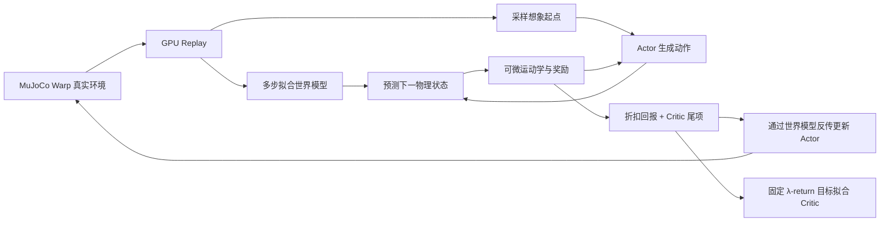

# 实现结构与论文对应

## 一轮训练的数据流

只有 MuJoCo Warp 执行真实物理；世界模型不会替代真实数据采集。WM、Actor 和 Critic 在训练循环中持续更新。
主训练入口为 `tasks/mimic/state_train.py`，早期 `train.py` 仅保留历史兼容。

## 状态、观测、目标和动作

| 名称 | 维度 | 内容 |
| --- | --- | --- |
| 物理状态 | 37 | 根部世界位置3、wxyz四元数4、关节位置12、根部世界线速度3、机身坐标角速度3、关节速度12 |
| 当前自身观测 | 42 | 关节角相对默认值12、关节速度12、机身角速度3、局部重力3、上次动作12 |
| Actor 历史 | 420 | 10帧自身观测；reset 用当前观测重复填充 |
| 未来目标 | 190 | 10帧，每帧关节位置12、根部位置3、四元数4 |
| 目标 latent | 32 | 未来目标经过编码器和 tanh |
| Actor 输出 | 12 | tanh 动作；按关节尺度转换为目标角 |
| sim context | 16 | 当前固定摩擦0.5，其余0；尚未启用物理参数随机化 |
| WM 输入 / 输出 | 65 / 37 | 状态37+动作12+context16；预测下一连续状态 |
| Critic 输入 | 664 | 状态37+目标190+context16+历史420+剩余时间1 |

关节顺序 FL、FR、RL、RR，每腿 hip、thigh、calf。四元数使用 wxyz；q/-q 表示同一朝向。
当前空翻任务关闭行走用的航向和前后误差附加观测。

## 网络与优化

- 策略目标编码器和解码器：隐藏层 `2048/1024/512/256`、ELU，目标 latent 为32维。
- Dynamics：`2048×3` MLP，预测标准化状态增量；输入状态使用首批真实数据校准后冻结的逐维均值/尺度，输出还原物理单位并归一化四元数。
- Critic：`256/128` MLP，输入包含真实策略历史及参考剩余时间，输出一个标量价值。
- 可选 BCE 终止头：`256/128`，输入归一化状态与目标。后空翻预设使用它；侧空翻使用解析平滑终止。
- WM 用多步标准化状态 MSE 拟合真实轨迹。跨 reset 后的样本不进入同一有效预测窗口，失败转移本身保留。
- Actor 在冻结参数的 WM/Critic 中闭环滚动。冻结参数仍允许奖励通过状态和动作反传。每批想象更新 Actor 一次；`--actor-rounds` 可重新采样后重复。
- Actor 目标为折扣/存活加权的预测奖励总和，加终点 Critic 价值；gamma=0.99。
- Critic 使用固定、detach 的 λ-return（λ=0.95）目标，默认5 epochs×4 minibatches。

动作先变成 `default_q + action_scales * action`，空翻按机械范围裁剪目标角；PD 在600Hz物理子步计算力矩，控制频率30Hz，Kp=25、Kd=0.5、力矩上限23.7 N·m。

## 奖励与参考采样

`rewards.py` 同时用于真实与想象：身体位置/朝向/线速度/角速度跟踪，根部位置/朝向跟踪，以及可配置的关节跟踪、动作变化、限位、力矩和关节加速度项。奖励率统一乘控制周期 dt；一次性失败惩罚不乘 dt。

17个跟踪刚体位姿由同一 MJCF 正运动学求得。真实身体速度用控制周期位姿差分，想象中用可微运动学计算同样的差分。当前身体位姿项直接比较世界坐标；没有实现 BeyondMimic 源码中的水平位置/yaw参考对齐。

空翻为单次动作。RSI 把参考分成约0.2秒一箱；20%的 reset 固定从开头，剩余按50%均匀、40%近期低回报、10%历史困难混合。分箱累计回报按剩余时长可得的最大回报归一化。每箱至少得到分箱混合部分的 `0.5 / 箱数`；这不是最终所有 reset 的比例。

## 论文对齐范围

参考 **SuperMimic, arXiv:2610.28480** 的真实采集、连续状态世界模型、可微闭环想象、Actor/Critic 交替训练结构；当前是 Go2 工程适配。

| 部分 | 当前实现 |
| --- | --- |
| 机器人与物理 | Go2，MuJoCo Warp，30Hz控制/600Hz物理 |
| 状态、网络与历史 | 明确的37维状态，10帧历史与10帧目标，MLP动力学 |
| 空间奖励 | 基本形式参考论文表A.2；任务有额外关节/力矩/加速度项，身体位姿坐标处理也有差异 |
| 终止 | 侧空翻解析 sigmoid，真实高度/倾斜硬阈值；后空翻可训练 BCE 终止头 |
| 域随机化 | context固定，未实现论文中的物理参数随机化 |
| 计算规模 | 本地显存配置，想象512起点×16步；不等同论文的环境数/batch |
| 验证 | 已有真实回放、短期预测及运动学梯度检查；训练 WM loss 不是独立泛化误差 |

演示证明了这套配置能够训练特定参考动作。论文宣称的训练加速倍数、多动作泛化和真实机器人能力不在本工程当前结果的验证范围内。
